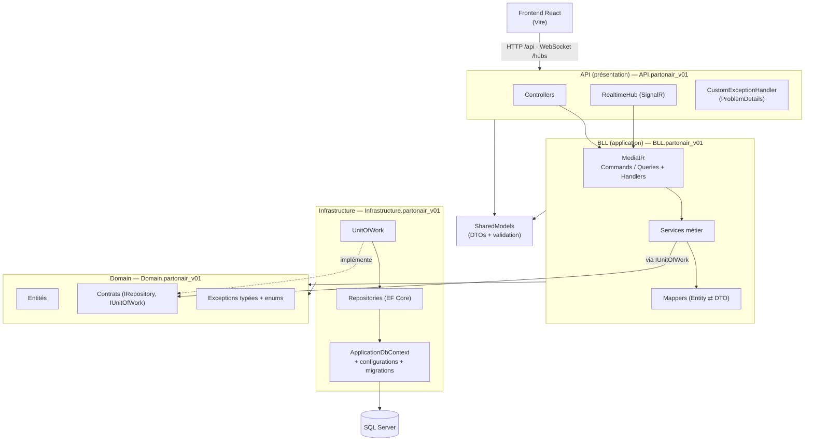
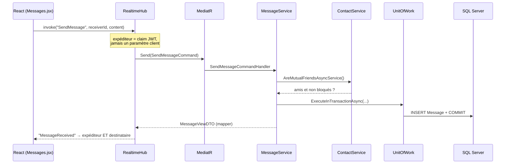
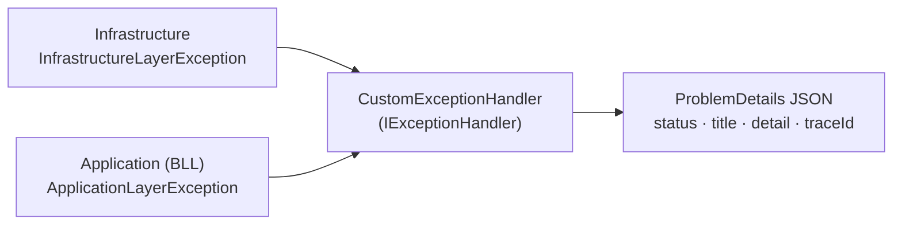

# Partonair

> Plateforme de mise en relation entre **chercheurs d'emploi** et **recruteurs** : profils, réseau de contacts, messagerie temps réel et avis entre membres.

Partonair est avant tout un **projet de montée en compétences**. L'objectif n'est pas de livrer un produit commercial, mais de construire une application full-stack réaliste pour pratiquer, de bout en bout, les patterns et outils de l'écosystème .NET moderne : **Clean Architecture, CQRS, Unit of Work, EF Core, SignalR, .NET Aspire**, et un front **React** actuel.

Chaque fonctionnalité sert de terrain d'entraînement : sécuriser une API par JWT, faire du temps réel proprement, modéliser des règles métier (blocage, avis réservés aux amis…), gérer les erreurs de façon homogène entre les couches, ou encore orchestrer l'environnement de développement avec Aspire.

---

## Sommaire

- [Fonctionnalités](#fonctionnalités)
- [Stack technique](#stack-technique)
- [Architecture](#architecture)
- [Patterns mis en place](#patterns-mis-en-place)
- [Accès aux données : EF Core](#accès-aux-données--ef-core)
- [Gestion des erreurs](#gestion-des-erreurs)
- [Sécurité](#sécurité)
- [Temps réel avec SignalR](#temps-réel-avec-signalr)
- [Orchestration avec .NET Aspire](#orchestration-avec-net-aspire)
- [Frontend](#frontend)
- [Structure du dépôt](#structure-du-dépôt)
- [Pistes d'amélioration](#pistes-damélioration)

---

## Fonctionnalités

| Domaine | Ce que l'application permet |
|---|---|
| **Comptes** | Inscription, connexion par JWT, mot de passe haché avec BCrypt |
| **Profils** | Rôle *chercheur d'emploi* ou *recruteur*, description, compétences, CV, page « Mon profil » éditable |
| **Profil recruteur** | Besoins structurés : poste recherché, types de contrat, localisation, télétravail, secteur |
| **Visibilité** | Profil public / privé, option « m'afficher dans mes recherches » ; un profil privé reste visible par ses amis |
| **Avatars** | Avatar [DiceBear](https://www.dicebear.com/) unique par profil, régénération limitée à 10 par jour (côté serveur) |
| **Annuaire** | Liste des profils publics par rôle, recherche, note moyenne affichée |
| **Réseau** | Demandes d'ami (envoyées / reçues), acceptation, refus, retrait |
| **Blocage** | Le membre bloqué garde l'historique en lecture seule, ne peut plus écrire ni renvoyer de demande ; seul l'auteur du blocage peut débloquer |
| **Messagerie** | Conversations privées 1:1 en temps réel, messages non lus, distinction « Moi / interlocuteur », séparateurs de date |
| **Notifications** | Toasts et badges temps réel : demande d'ami, nouveau message, nouvel avis |
| **Évaluations** | Note de 0 à 5 + commentaire justifié, un avis par membre (modifiable), réservé aux amis, moyenne sur le profil |

---

## Stack technique

### Backend

| Outil | Rôle |
|---|---|
| **.NET 10 / ASP.NET Core** | API REST (controllers) |
| **.NET Aspire 13** | Orchestration du dev local, *service defaults* (télémétrie, health checks, résilience) |
| **Entity Framework Core 10** | ORM, migrations, SQL Server |
| **SQL Server** | Base de données (conteneur Docker piloté par Aspire) |
| **Redis** | Output cache (conteneur piloté par Aspire) |
| **MediatR 14** | Implémentation de CQRS (commandes / requêtes et leurs handlers) |
| **SignalR** | Communication temps réel (messages, notifications) |
| **JWT Bearer** | Authentification stateless |
| **BCrypt.Net-Next** | Hachage des mots de passe (`EnhancedHashPassword`) |
| **Swagger, Scalar, OpenAPI** | Documentation interactive de l'API (commentaires XML) |
| **OpenTelemetry** | Logs, traces et métriques, visibles dans le dashboard Aspire |

### Frontend

| Outil | Rôle |
|---|---|
| **React 19** | Interface |
| **Vite 7** | Build et serveur de dev (proxy `/api` et `/hubs` vers l'API) |
| **React Router 7** | Routage |
| **Tailwind CSS 3 + Flowbite** | Styles (thème sombre « glass », palette `electric`) |
| **@microsoft/signalr** | Client temps réel |

---

## Architecture

Le backend suit une **Clean Architecture** en couches. Les dépendances pointent vers le centre : le **Domain** ne dépend de rien, et la couche métier (**BLL**) ne connaît que des **interfaces** de repositories, jamais leur implémentation EF Core.



### Rôle de chaque projet

| Projet | Couche | Contenu | Dépend de |
|---|---|---|---|
| `Domain.partonair_v01` | Cœur | Entités (`User`, `ProfileUser`, `Contact`, `Message`, `Evaluation`…), enums, **contrats** (`IGenericRepository<T>`, `IUnitOfWork`…), exceptions typées | — |
| `SharedModels.partonair_v01` | Contrats d'échange | **DTOs** (records) avec leurs attributs de validation, attribut custom `AllowedRoles` | Domain (enums) |
| `BLL.partonair_v01` | Application | **Services métier** (règles), **MediatR** (commandes / requêtes), **mappers** | Domain, SharedModels |
| `Infrastructure.partonair_v01` | Infrastructure | `ApplicationDbContext`, configurations Fluent API, **migrations**, **repositories**, **UnitOfWork** | Domain, SharedModels |
| `API.partonair_v01` | Présentation | Controllers, hub SignalR, middleware d'erreurs, JWT, injection de dépendances | BLL, Infrastructure, SharedModels |
| `Aspire.partonair_v01.AppHost` | Orchestration | Démarre SQL Server, Redis, l'API et le front | API |
| `frontend.partonair-v01` | UI | Application React | API (HTTP / WebSocket) |

> L'API référence l'Infrastructure **uniquement pour la composition** (enregistrement des implémentations dans le conteneur d'injection). Le code métier, lui, ne voit que les interfaces.

### Le parcours d'une requête

Exemple : un membre envoie un message à un ami.



1. Le **controller ou le hub** ne contient aucune logique métier. Il récupère l'identité depuis le JWT et envoie une **commande** ou une **requête** MediatR.
2. Le **handler** délègue au **service**, qui applique les règles : amitié, blocage, quotas, propriété de la ressource…
3. Le service passe par l'**Unit of Work** pour accéder aux repositories et valider la transaction.
4. L'entité est convertie en **DTO** par un mapper. Une entité EF Core ne sort jamais de la couche métier.
5. En cas d'erreur, une **exception typée** remonte jusqu'au middleware, qui la traduit en réponse HTTP normalisée.

---

## Patterns mis en place

### CQRS avec MediatR

Les cas d'usage sont séparés en **commandes** (qui modifient l'état) et en **requêtes** (qui lisent), chacune avec son handler :

```
BLL.partonair_v01/MediatR/
├── Commands/   Contacts · Evaluations · Messages · Profiles · Users
└── Queries/    Contacts · Evaluations · Messages · Profiles · Users
```

```csharp
// Requête : un record immuable qui décrit l'intention…
public record GetUserEvaluationsQuery(Guid ViewerId, Guid UserId) : IRequest<UserEvaluationsDTO>;

// …et son handler, qui délègue au service métier
public class GetUserEvaluationsQueryHandler(IEvaluationService evaluationService)
    : IRequestHandler<GetUserEvaluationsQuery, UserEvaluationsDTO>
{
    public async Task<UserEvaluationsDTO> Handle(GetUserEvaluationsQuery request, CancellationToken ct)
        => await evaluationService.GetUserEvaluationsAsyncService(request.ViewerId, request.UserId);
}
```

Les controllers ne dépendent ainsi que d'`IMediator`. Ajouter un cas d'usage revient à ajouter un couple *requête + handler*, sans toucher aux autres. Tous les handlers sont découverts automatiquement par analyse de l'assembly BLL.

### Repository générique + repositories spécialisés

- `IGenericRepository<T>` (dans le Domain) fournit le CRUD commun (`CreateAsync`, `Update`, `Delete`, `GetByGuidAsync`, `GetAllAsync`).
- Chaque agrégat a son repository spécialisé pour les requêtes métier : `GetPairAsync` (relation entre deux membres), `CountUnreadBySenderAsync`, `GetByReceiverAsync`…
- Les repositories gèrent les `Include` / `ThenInclude` : le service reçoit des entités déjà complètes et ne manipule jamais `DbSet` directement.

### Unit of Work

`UnitOfWork` expose tous les repositories, instanciés à la demande sur **le même `DbContext`**, et gère les transactions :

```csharp
public IMessageRepository Messages => _messageRepository ??= new MessageRepository(_context);

// Transaction compatible avec la stratégie de ré-essai d'EF Core (execution strategy)
return await _UOW.ExecuteInTransactionAsync(async () =>
{
    var sender   = await _UOW.Users.GetByGuidAsync(senderId);
    var receiver = await _UOW.Users.GetByGuidAsync(receiverId);
    var created  = await _UOW.Messages.CreateAsync(message);
    return created.ToView();   // SaveChanges + Commit automatiques, Rollback en cas d'exception
});
```

Une opération qui touche plusieurs tables reste **atomique**. C'est le cas du blocage, qui met à jour la relation et refuse la demande en attente dans la même transaction.

### DTOs et validation

- Les DTOs sont des **records C#** immuables, regroupés dans `SharedModels` : `ProfileCreateDTO`, `MyProfileViewDTO`, `ConversationViewDTO`, `RelationshipDTO`…
- La **validation d'entrée** passe par les DataAnnotations (`[Required]`, `[MinLength]`, `[Range(0, 5)]`…) et un attribut custom `[AllowedRoles]`. `[ApiController]` renvoie automatiquement un **400** si le DTO est invalide.
- Les **règles qui dépendent du contexte** sont vérifiées dans les services : poste obligatoire pour un recruteur, avis réservé aux amis, quota d'avatars, propriété d'un profil…
- Il y a des DTOs distincts selon l'usage : *create*, *update*, *view*, et des vues **par point de vue**. Par exemple, `MyContactViewDTO` décrit « l'autre membre » d'une relation, et `RelationshipDTO` vaut `BlockedByMe` ou `BlockedByOther` selon qui la consulte.

### Mapping

Le mapping est **manuel**, par méthodes d'extension, sans AutoMapper. C'est explicite, vérifié à la compilation et simple à déboguer :

```csharp
internal static EvaluationViewDTO ToView(this Evaluation eval) => new(
    eval.Id, eval.EvaluationValue, eval.EvaluationCommentary,
    eval.EvaluationCreatedAt, eval.EvaluationUpdatedAt,
    eval.EvalReceiverId, eval.EvalSenderId,
    eval.Sender.Name, eval.Sender.Role.ToString(), eval.Sender.ProfileUser?.AvatarSeed);
```

Les mappers transforment aussi les données au passage. Par exemple, les types de contrat sont stockés en `[Flags]` (un entier) en base et exposés sous forme de liste dans l'API.

### Injection de dépendances par couche

`DependencyInjectionManager` organise l'enregistrement des services en trois méthodes d'extension, une par couche. `Program.cs` reste ainsi très court :

```csharp
builder.Services.AddPresentationAPILayer(builder.Configuration)
                .AddApplicationLayer()
                .AddInfrastructureLayer();
```

### Autres patterns

- **Adapter** : `LoggerAdapter<T>` (interface `ILoggerAdapter<T>`) est prêt à isoler la couche métier de `ILogger<T>` et à faciliter les tests. Il n'est pas encore branché dans l'injection de dépendances.
- **Options pattern** : la configuration JWT est liée à `JwtSettings` via `IOptions<JwtSettings>`.
- **Design-time factory** : `ApplicationDbContextFactory` permet à `dotnet ef` de créer les migrations sans démarrer l'application.

---

## Accès aux données : EF Core

- **Approche code-first.** Chaque entité a sa classe `IEntityTypeConfiguration<T>` (Fluent API) : noms de colonnes en *snake_case*, longueurs maximales, valeurs par défaut SQL (`NEWSEQUENTIALID()`, `SYSUTCDATETIME()`…), relations et comportements de suppression.
- **Contraintes en base**, en plus des validations applicatives :
  - **check constraints** : pas de message à soi-même, contenu non vide, note entre 0 et 5 ;
  - **index uniques** : un profil par utilisateur, un avis par couple auteur / membre évalué ;
  - **index composites** : historique d'une conversation, messages non lus.
- **Conversions de valeurs** : enums stockés en texte (`RemotePolicy`, `Sector`) ou en flags entiers (`ContractTypes`).
- **Migrations versionnées**, dont certaines contiennent du SQL de reprise de données. Par exemple :
  - l'historique existant est marqué « lu » lors de l'ajout de `read_at` ;
  - les avis en double sont supprimés avant la création de l'index unique ;
  - les moyennes existantes sont calculées.
- **Mises à jour en masse** avec `ExecuteUpdateAsync` (marquer une conversation comme lue) : une seule requête SQL, sans charger les entités.
- **Dénormalisation assumée** : la moyenne et le nombre d'avis sont stockés sur le profil et recalculés à chaque avis. L'annuaire n'a donc pas besoin d'agréger à chaque carte.
- **Migration automatique au démarrage**, avec ré-essais le temps que le conteneur SQL Server soit prêt.

---

## Gestion des erreurs

Chaque couche lève **ses propres exceptions typées**, qui portent un code d'erreur (enum). Un seul middleware les traduit en réponse HTTP au format **ProblemDetails** ([RFC 9457](https://www.rfc-editor.org/rfc/rfc9457)).



| Exception | Code d'erreur | HTTP |
|---|---|---|
| `ApplicationLayerException` | `EntityIsNotExisting` | 404 |
| | `ConstraintViolation` (règle métier non respectée) | 409 |
| | `QuotaExceeded` (ex. avatars) | 429 |
| | `SaltParseBCrypt`, `Unexpected` | 500 |
| `InfrastructureLayerException` | `ResourceNotFound` | 404 |
| | `EntityIsNull`, `Cancelation` | 400 |
| | `ConcurrencyDatabase` | 409 |
| | `DatabaseConnectionError` | 503 |
| Toute autre exception | — | 500 |

Ce découpage a plusieurs effets :
- Les **repositories** convertissent les exceptions EF Core (annulation, concurrence…) en exceptions d'infrastructure. Aucun type EF Core ne remonte dans les couches supérieures.
- Les **services** n'ont pas à connaître HTTP. Ils lèvent une exception métier avec un message lisible (« Ce contact t'a bloqué : tu ne peux plus lui écrire. »).
- Côté **SignalR**, le hub transforme ces exceptions en `HubException`, et seul l'appelant reçoit le message.
- Le **front** lit le `detail` de la réponse pour l'afficher tel quel à l'utilisateur.

---

## Sécurité

- **JWT HS256** signé avec une clé de 256 bits minimum. Sa présence et sa taille sont **vérifiées au démarrage**. L'émetteur, le destinataire et la durée de vie sont validés, sans tolérance d'horloge (`ClockSkew = 0`).
- **Aucun secret dans le dépôt.** En développement, la clé vient des **user-secrets** .NET. Ailleurs, elle vient de la variable d'environnement `JWT__SecretKey`.
- **L'identité vient toujours du token.** L'auteur d'un message, d'un avis ou d'une demande est lu dans le claim `NameIdentifier`, jamais dans la requête du client.
- **Contrôle de propriété** : on ne peut modifier que son propre profil ou son propre avis, et seul l'auteur d'un blocage peut le lever.
- **Policies par rôle** (`Visitor`, `Employee`, `Company`, `Admin`) pour les routes d'administration.
- **Mots de passe** hachés avec `BCrypt.EnhancedHashPassword`.
- **Quotas côté serveur** : la régénération d'avatar est limitée pour ne pas surcharger l'API externe DiceBear.

---

## Temps réel avec SignalR

- **Un seul hub**, `RealtimeHub` (`/hubs/realtime`), protégé par `[Authorize]`. Chaque utilisateur n'ouvre qu'**une seule connexion WebSocket**, partagée par la messagerie et les notifications.
- Le WebSocket ne peut pas transmettre l'en-tête `Authorization`. Le token passe donc en **query string**, et il n'est accepté que sur les routes `/hubs`.
- **Ciblage par utilisateur** : `Clients.User(userId)` atteint tous les onglets ou appareils de ce membre, grâce au claim `NameIdentifier`.
- **Les controllers notifient aussi**, via `IHubContext<RealtimeHub>` : une action REST, comme une demande d'ami ou un blocage, déclenche un événement temps réel.

| Événement | Déclencheur |
|---|---|
| `MessageReceived` | Nouveau message (envoyé par le hub ou, en secours, par REST) |
| `FriendRequestReceived` | Demande d'ami reçue |
| `RelationshipChanged` | Blocage / déblocage (les deux membres sont prévenus) |
| `EvaluationReceived` / `EvaluationRemoved` | Avis publié, modifié ou supprimé |

Côté front, un `RealtimeProvider` gère la connexion (reconnexion automatique, rechargement des données après une coupure). Les pages s'**abonnent** simplement aux événements dont elles ont besoin.

---

## Orchestration avec .NET Aspire

L'**AppHost** décrit l'environnement complet en C# et le démarre en une seule commande :

```csharp
var cache = builder.AddRedis("cache");

var db = builder.AddSqlServer("sqldata")
                .WithDataVolume("sql-data")      // données persistées entre deux lancements
                .AddDatabase("partonairdb");

var server = builder.AddProject<Projects.API_partonair_v01>("server")
                    .WithReference(cache).WaitFor(cache)
                    .WithReference(db)
                    .WithHttpHealthCheck("/health");

builder.AddViteApp("webfrontend", "../frontend.partonair-v01")
       .WithReference(server).WaitFor(server);
```

Ce que ça apporte :
- **Les conteneurs Docker** (SQL Server, Redis) sont créés et reliés automatiquement : pas de chaîne de connexion à écrire à la main.
- **Un ordre de démarrage garanti** (`WaitFor`) et un suivi de santé (`/health`).
- **Les *service defaults*** (`Extensions.cs`) partagés par les services : OpenTelemetry (logs, traces, métriques), health checks, résilience HTTP et découverte de services.
- **Le dashboard Aspire** : logs, traces distribuées et état de chaque ressource au même endroit.
- **Le front Vite** reçoit l'adresse de l'API par variable d'environnement, ce qui permet à son proxy de la joindre.

---

## Frontend

- **Une page par domaine** : accueil, `Mon profil`, création de profil, annuaire, fiche d'un membre, réseau, messagerie.
- **L'état global passe par des contextes React** :
  - `AuthContext` : la session, persistée dans `localStorage` ;
  - `RealtimeContext` : la connexion SignalR et l'abonnement aux événements ;
  - `NotificationsContext` : les compteurs de non-consultés et les toasts ;
  - `ModalContext` : les fenêtres de connexion et d'inscription.
- **Une couche `services/api.js`** centralise les appels HTTP. Elle ajoute le token et transforme les erreurs ProblemDetails en messages lisibles.
- **Des composants réutilisables** : `ProfileAvatar`, `StarRating`, `EvaluationsSection`, `RecruiterNeedsFields`, `Toasts`…
- **Accessibilité** : rôles ARIA (`tablist`, `switch`, `radiogroup`, `status`), libellés pour les lecteurs d'écran, focus visibles.

---

## Structure du dépôt

```
Solution.partonair-v01/
├── Aspire.partonair-v01/
│   ├── Aspire.partonair-v01.AppHost/      # Orchestration .NET Aspire
│   ├── Aspire.partonair-v01.Server/       # API : Controllers, Hubs, Token, GlobalManager, Middleware
│   └── frontend.partonair-v01/            # React + Vite + Tailwind
├── BLL.partonair_v01/                     # Services, MediatR (Commands/Queries), Mappers, Interfaces
├── Domain.partonair_v01/                  # Entities, Enums, Contracts, Exceptions
├── Infrastructure.partonair_v01/          # EF Core : DbContext, Configurations, Migrations, Repositories, UnitOfWork
├── ShareModels.partonair-v01/             # DTOs + attributs de validation
└── PLAN-TODO.md                           # Suivi des lots de la v0.2
```

---

## Pistes d'amélioration

Quelques pistes, puisque le projet reste un terrain d'apprentissage :

- **Tests automatisés** : tests unitaires des services (règles d'amitié, de blocage, d'avis) et tests d'intégration de l'API, avec `WebApplicationFactory` et une base de test.
- **Pagination** de l'annuaire et de l'historique des messages.
- **Demande refusée** : permettre une nouvelle demande après un délai, au lieu de bloquer définitivement.
- **CORS** : remplacer `AllowAnyOrigin` (pratique en dev) par une liste d'origines en production.
- **Connexion Google**, commencée dans `SigninGoogleController` et à finaliser.
- **Signalement d'un avis abusif** et modération par un administrateur.
